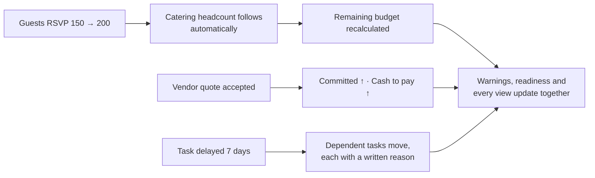
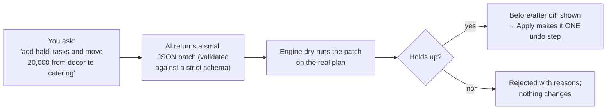
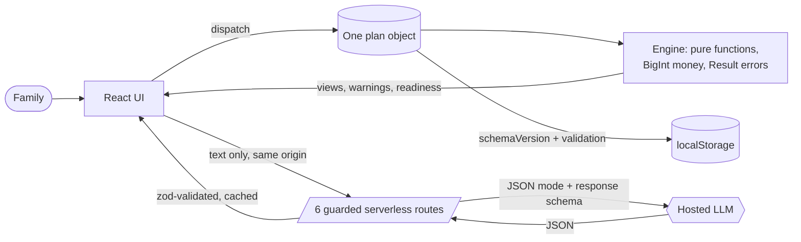

<p align="center"></p>

# Utsav · उत्सव

### Every utsav, one connected plan.

One plan for budget, timeline, guests, vendors and payments — where every change moves
everything else, instantly, in the browser. **The AI proposes; the engine disposes.**

[](https://github.com/RohitDeore96/Eventplanner/actions)


**[🌐 Live app — verified](https://eventplanner-mocha.vercel.app/)** · MIT license · built for PromptWars Virtual, Challenge 5: Celebration & Event Planner

---

<table>
<tr>
<td align="center"><b>1 plan</b><br/><sub>budget, timeline, guests, vendors and payments stay in sync</sub></td>
<td align="center"><b>3 occasions</b><br/><sub>wedding, kid's birthday, community festival — each with its own presets</sub></td>
<td align="center"><b>6 guarded AI touchpoints</b><br/><sub>language only, never the maths</sub></td>
<td align="center"><b>1 engine</b><br/><sub>pure TypeScript; the AI can't touch a single rupee</sub></td>
</tr>
</table>

<p align="center">
  
  
</p>
<p align="center">
  
</p>

**Jump to:** [The problem](#-the-problem) · [The idea](#-the-idea-one-plan-everything-connected) · [The design rule](#%EF%B8%8F-the-design-rule-the-ai-proposes-the-engine-disposes) · [Try it](#%EF%B8%8F-try-it-in-two-minutes) · [Features](#-what-it-does) · [Architecture](#%EF%B8%8F-architecture) · [AI usage](#-ai-usage) · [How Utsav compares](#-how-utsav-compares) · [Quality](#-quality) · [Security](#-security) · [Run locally](#-run-it-locally) · [Deploy](#-deploy-on-vercel)

## 🤯 The problem

The budget lives in a notebook. The guest list lives on WhatsApp. The caterer's quote lives
in a voice note. The deadlines live in somebody's head. Then the guest list grows by 50, and
nobody can say what that does to the catering bill, the venue, or the date by which the
caterer must be told.

Event planning is not one problem. It is a set of **connected** problems:

- 👥 guest count drives catering and seating
- 💰 the budget drives every category
- 📅 the event date drives the whole timeline
- 🧾 every vendor quote and payment changes what is committed, what is paid and what is left

Spreadsheets and chat threads do not move together. Utsav does.

## 💡 The idea: one plan, everything connected

Utsav keeps a **single plan object** reduced by **one pure engine**. Any change — guests,
budget, date, a vendor quote, a payment, a delayed task — re-runs the engine and every view,
warning and readiness figure updates from the same numbers. There is no second place where
the truth could live, so the totals can never disagree.



The engine is deterministic, integer-only (BigInt minor units), and has no clock and no
network: `today` is passed in, so tests can prove behaviour on any date.

## ⚖️ The design rule: the AI proposes, the engine disposes

Most AI planners let the model touch numbers directly. Utsav refuses. A deterministic engine
owns all money and all dates; the hosted LLM only does what needs language understanding —
and even its **changes** are treated as untrusted proposals:



- The patch is a list of engine actions, not free-form edits — the AI can only do what an
  action expresses, and `reducePlan` re-validates everything.
- Every AI reply is labelled with its source: the model that answered, or **"built-in"**.
- **With no API key the app stays fully usable**: every AI panel answers from a built-in
  deterministic planner and says so. Nothing is ever invented.

## ⏱️ Try it in two minutes

Open the **[live app](https://eventplanner-mocha.vercel.app/)**:

1. 🎬 Press **Load demo event** — "Asha & Dev", a full wedding with vendors, instalments,
   expenses, RSVPs and one overdue payment appears instantly, so every screen has real data.
2. 💰 **Budget.** Read _planned / committed / paid / remaining_ per category — they always
   reconcile. The warning card states the problem in words ("₹40,000 of ₹80,000 was due
   2026-10-15") **and** a suggested fix.
3. 📅 **Timeline.** Eleven dependency-ordered tasks. Press **Delay 7d** on _Book the venue_
   and watch downstream tasks move with reasons. **Add timeline to calendar (.ics)** puts
   every date and reminder on your phone.
4. 👥 **Guests.** Add guests one line at a time, flip RSVPs, set dietary preferences
   (vegetarian, vegan, jain and more) — and watch the catering headcount and dietary
   counts follow automatically.
5. 🧾 **Vendors.** Each vendor has a booking status and a payment schedule. Paste a quote
   and AI reads the fields — anything not stated stays empty and is flagged as a gap
   ("no cancellation policy") rather than guessed.
6. 🧭 **Assistant.** Ask _"Kitna kharcha bacha hai?"_, get occasion-tuned ideas, and — the
   differentiator — **ask AI to change the plan**: it proposes a patch, the engine dry-runs
   it, you see the exact before/after, and **Apply** makes it one undo step. Reject does
   nothing at all.
7. ↩️ **Undo everything.** Every change — yours or AI's — is one undo step. **Export
   JSON/CSV** gives you the real data, not a summary.

## ✨ What it does

| You need to                    | Utsav gives you                                                                                                                 |
| ------------------------------ | ------------------------------------------------------------------------------------------------------------------------------- |
| 💰 Keep spending in check      | Occasion presets, per-category planned/committed/paid/remaining that always reconcile, expense log, over-allocation guards      |
| 🧾 Pay vendors in instalments  | Scheduled payments per vendor, partial payments, "partly paid — balance due" flags, cash-to-pay total                           |
| 📅 Never miss a deadline       | Dependency-aware timeline with overdue and impossible flags, delay propagation with written reasons, **calendar export (.ics)** |
| 👥 Survive a bigger guest list | RSVP tracking (confirmed/declined) with dietary needs feeding the catering headcount automatically                              |
| 🧾 Read vendor quotes          | AI quote extraction with **honest gaps**: unstated fields stay empty and are flagged, never guessed                             |
| 📋 Know who to book            | A vendor checklist per occasion with statuses, and per-vendor payment tracking                                                  |
| 💡 Get fresh ideas             | Occasion-tuned themes, activities, food style and personal touches — **no prices, ever**                                        |
| 🧭 Ask about your plan         | A planner that answers in English or Hinglish, grounded in the plan's own facts, with a built-in fallback when AI is down       |
| 🤖 Change plans by sentence    | Free-text → AI patch → engine dry-run → before/after → approve as one undo step (or reject, changing nothing)                   |
| ↩️ Change your mind            | Undo/redo for every accepted change, **Load demo event**, Reset, JSON/CSV export                                                |
| 🌙 Work anywhere               | Designed dark mode, 44 px touch targets, keyboard-operable throughout, WCAG 2.1 AA contrast enforced by test in both themes     |

## ⚖️ How the work is split

|                                                          | Deterministic engine (`src/engine`) | Hosted LLM (`api/`, server only) |
| -------------------------------------------------------- | :---------------------------------: | :------------------------------: |
| Money: allocation, expenses, instalments, reconciliation |                 ✅                  |                                  |
| Scheduling, dependencies, delay ripple, .ics             |                 ✅                  |                                  |
| Guests, RSVPs, catering headcount                        |                 ✅                  |                                  |
| Warnings with plain-language fixes                       |                 ✅                  |                                  |
| Vetting AI patches (dry-run gate)                        |                 ✅                  |                                  |
| Built-in answers when AI is unavailable                  |                 ✅                  |                                  |
| Read a free-text event description                       |                                     |                ✅                |
| Read a pasted vendor quote                               |                                     |                ✅                |
| Ideas, plan review, answers grounded in plan facts       |                                     |                ✅                |
| Propose small patches (engine still gates them)          |                                     |                ✅                |

## 🏗️ Architecture



**One reducer** (`reducePlan`) handles every change — manual edits and accepted AI patches
alike — so undo treats an AI patch as one step. Engine functions return `Result<T>` with a
stable error code, a human message and the offending field; the reducer never throws on
arbitrary input (fuzz-tested).

| Module                     | Responsibility                                                                 |
| -------------------------- | ------------------------------------------------------------------------------ |
| `money.ts`                 | integer minor units, BigInt parsing, cached locale formatters                  |
| `budget.ts`                | allocation, expenses, instalments, committed vs paid                           |
| `tasks.ts` · `timeline.ts` | dependency graph, delay propagation, overdue/impossible flags                  |
| `guests.ts`                | RSVPs, dietary counts, catering headcount                                      |
| `vendors.ts`               | checklist statuses, payment schedules                                          |
| `patch.ts`                 | dry-run gate: validate an AI patch against the real plan before anyone sees it |
| `ics.ts`                   | RFC 5545 calendar export with escaping and reminders                           |
| `scenario.ts`              | what-if comparisons without touching the live plan                             |
| `history.ts`               | undo/redo as first-class engine state                                          |
| `summary.ts`               | readiness, totals, warning roll-up                                             |

## 🤖 AI usage

- **Server only.** The API key is read inside serverless functions, never in the browser,
  the repo or the logs. The browser talks only to same-origin `/api/*` routes.
- **JSON mode with a response schema** derived from the same zod schemas the app uses; the
  reply is validated on the server (`502 AI_RESPONSE_INVALID` on failure) and again on the
  client. Raw model text never reaches the UI.
- **Model chain with automatic failover.** A configurable list (`GEMINI_MODEL`), newest
  documented models first; if one is overloaded or retired, the next answers. The UI never
  shows the shuffle — each reply simply labels who answered.
- **Guarded routes.** POST-only (405), same-origin only (403), JSON-only (415), 8 KB body
  cap (413), schema validation (400), per-IP rate limit 20/5 min (429), 15 s timeout (504),
  a daily global AI cap (429), and safe error codes only — never a stack trace.
- **Prompt-injection guard.** User text is wrapped in data tags with closing-tag tricks
  stripped; the model is told user text is data, never instructions; it may never invent
  prices, vendors or availability; unknown fields stay `null`.
- **Cache.** Identical validated requests within 10 minutes are served from an in-memory
  cache, so repeats cost nothing.
- **Fallbacks first.** AI down or no key → every panel degrades to the built-in planner and
  labels the answer "built-in". Budget, timeline, guests, vendors and export never depend
  on AI at all.
- **Plain transport.** The AI layer is a thin `fetch` call to the provider's JSON-mode REST
  endpoint — no heavy SDK in the serverless bundle, tiny cold starts, nothing to trace.

## 🆚 How Utsav compares

Utsav was built as an independent take after studying the public write-ups of this
challenge's top entries — especially **the benchmark app**
([the benchmark repository](https://github.com/the benchmark repository)),
whose "one plan, everything connected" architecture this project admires and pushes further.
Nothing was copied; the comparison below is factual and sourced from both public READMEs.

| Capability                    | the benchmark app                                            | Utsav                                                                                                             |
| ----------------------------- | -------------------------------------------------- | ----------------------------------------------------------------------------------------------------------------- |
| Core architecture             | One plan object + deterministic engine             | Same principle, plus **Result-typed errors** and BigInt minor units                                               |
| AI changes the plan           | AI explains engine-generated over-budget options   | **Free-text → AI patch → engine dry-run → before/after → one-undo-step apply**, for budget _and_ timeline changes |
| Guests                        | On their roadmap ("what's next")                   | **Shipped**: RSVPs with dietary needs feeding catering headcount                                                  |
| Vendor payments               | On their roadmap                                   | **Shipped**: instalment schedules, partial payments, cash-to-pay, "partly paid" flags                             |
| Calendar export               | Yes (.ics)                                         | Yes (.ics)                                                                                                        |
| Demo content                  | None — you build a plan to see data                | **Load demo event**: full wedding in one click, every screen instantly populated                                  |
| Undo/redo                     | Not mentioned                                      | Every change (yours and AI's) is one undo step                                                                    |
| Honest fallbacks              | Yes                                                | Yes — every reply labels its source; a live "AI offline" banner instead of silent failure                         |
| End-to-end browser tests      | **Stronger**: 14 Playwright e2e specs              | Component + axe tests in jsdom; real-browser e2e on the roadmap                                                   |
| Share links & print summary   | **Stronger**: shareable link + printable one-pager | JSON/CSV export instead; share links on the roadmap                                                               |
| Shared rate-limit/cache store | **Stronger**: optional Upstash/KV shared store     | Per-instance in-memory (stated plainly in Security)                                                               |

## ✅ Quality

### Code quality

- TypeScript `strict` with `noUncheckedIndexedAccess`; no `any`, no `@ts-ignore`.
- ESLint **typescript-eslint strictTypeChecked** with zero findings; Prettier enforced.
- Business logic only in `src/engine` as pure functions; components render and dispatch;
  API handlers are thin (guard → validate → call → validate → respond).
- `dependency-cruiser` enforces the layering (UI → engine, no cycles, no orphans); `knip`
  fails on unused files and exports.
- Every new dependency needs a one-line justification in [docs/DECISIONS.md](docs/DECISIONS.md).

### Testing: 356 automated tests

`npm run check` = format + lint + types + architecture + unused code + tests with enforced
coverage thresholds (95% lines / 94% statements / 94% functions / 83% branches — a ratchet
that may only move up).

- **Engine**: unit tests per module, snapshot tests for occasion presets, and **property
  tests with fast-check**: arbitrary JSON as an action never throws, category totals always
  sum exactly to the budget, schedules never contain cycles.
- **API routes**: the real handlers with a mocked AI endpoint — 405/403/415/400/413/429/503/
  502 paths, cache-hit proof, input-sensitivity proof, model-chain failover proof, and the
  no-key fallback path as a first-class test.
- **UI**: component tests for every view, the AI patch flow (dry-run → apply → undo),
  persistence with schema migration, the demo event, and **axe accessibility scans** plus
  **token-level WCAG contrast math in both themes**.
- **Mutation testing** is configured (`npm run mutation`) as a scheduled job: it measures
  whether the tests actually catch bugs, not just whether they pass.
- `docs/METRICS.md` is **generated from real runs** (`node scripts/gen-metrics.mjs`) —
  nothing there is typed by hand, and every check it reports is one of the gates CI runs.

### ♿ Accessibility (WCAG 2.1 AA)

Skip link, landmarks, labelled inputs, error alerts wired to fields, visible focus rings,
44 px touch targets, `aria-live` for statuses and AI results, status always **text + icon
(never colour alone)**, tables with `th scope`, labelled progress bars, light/dark token
contrast enforced by test, `prefers-reduced-motion` / `prefers-contrast` / forced-colours
support. **Not yet tested with real screen readers** — stated honestly.

## 🔒 Security

| Area         | What Utsav does                                                                                                                                            |
| ------------ | ---------------------------------------------------------------------------------------------------------------------------------------------------------- |
| Secrets      | API key only inside serverless functions; `.env` gitignored; `.env.example` has placeholders; secret scan in the repo (`scripts/secret-scan.mjs`)          |
| Input        | zod validation on every endpoint and on every AI reply; 8 KB body cap; oversized/invalid → 400/413                                                         |
| Abuse        | POST only, JSON only, **same-origin only** (403 otherwise — other sites cannot spend the AI quota), per-IP rate limit (20/5 min), daily global AI cap      |
| Output       | Schema-validated before returning; errors carry a code only, never a stack trace or user text                                                              |
| Browser      | Strict CSP **without `unsafe-inline`**, HSTS (2 years, preload), `frame-ancestors 'none'`, nosniff, COOP, referrer + permissions policy (`vercel.json`)    |
| Persistence  | Saved plans are untrusted: size cap → schema → `schemaVersion` migration → engine re-validation; the reducer never throws on arbitrary input (fuzz-tested) |
| Supply chain | `npm audit` clean at high severity for runtime deps, lockfile committed, CI uses `npm ci`                                                                  |

Residual risks and the full threat model: [SECURITY.md](SECURITY.md).

## 🆘 Honest limits

- The rate limiter and daily AI cap are **per serverless instance** (no shared store yet).
- Accessibility is tested with axe in jsdom and token math — not yet with real screen readers.
- The quote reader depends on what the pasted text says; unstated fields stay empty on purpose.
- Scenario comparison and share links are engine-ready but not yet in the UI.
- Real-browser Playwright e2e is on the roadmap; current browser-adjacent coverage is
  component-level (axe + jsdom).
- Until the owner sets `GEMINI_API_KEY` in the Vercel dashboard, the live AI panels answer
  from the built-in planner — which is itself worth trying, because it is the honesty path.

## 🇮🇳 Assumptions (all editable in the app)

- Occasion splits (wedding: venue 30%, catering 30%, photography 10%, decor 8%, music 6%,
  attire 6%, contingency 10%) are documented starting points, not market data.
- A scheduled payment settles only when summed payments reach its amount; partial and
  multiple payments are supported; overpaying warns instead of hiding.
- ₹ formatting uses Indian digit grouping (`₹8,00,000`); currency is switchable (USD, EUR,
  GBP, AED, JPY) and the whole plan re-formats.
- AI intake and quote readings are suggestions to verify — every reply says where it came from.

## 🚀 Run it locally

```bash
git clone https://github.com/RohitDeore96/Eventplanner.git
cd Eventplanner
npm install
cp .env.example .env    # optional: add GEMINI_API_KEY for the AI features
npm run api             # terminal 1: the same handlers Vercel runs, on :8787
npm run dev             # terminal 2: the app on :5173 (proxies /api)
```

| Command                        | What it does                                                                 |
| ------------------------------ | ---------------------------------------------------------------------------- |
| `npm run check`                | format, lint, types, architecture rules, unused code, tests + coverage gates |
| `npm test`                     | the whole suite                                                              |
| `npm run build`                | production build                                                             |
| `node scripts/gen-metrics.mjs` | regenerate `docs/METRICS.md` from real runs                                  |
| `node scripts/secret-scan.mjs` | scan the repo for accidental secrets                                         |
| `npm run mutation`             | Stryker mutation testing (slow; scheduled job)                               |

Environment: `GEMINI_API_KEY` (optional — the app is fully usable without it),
`GEMINI_MODEL` (optional; overrides the model chain), `AI_DAILY_CAP` (optional).

## ☁️ Deploy on Vercel

1. Push this repo to GitHub, then **Vercel → Add New → Project → Import** the repo.
2. Vercel auto-detects Vite (`vercel.json` pins the settings). Deploy.
3. **Settings → Environment Variables → add `GEMINI_API_KEY`** (from the AI provider's
   console), then redeploy — that is the only step that turns on the AI features.
4. Every push to `main` redeploys automatically. Security headers come from `vercel.json`;
   the six serverless functions in `api/` are picked up automatically.

More detail in [docs/AUDIT.md](docs/AUDIT.md) (defects found and fixed) ·
[docs/ARCHITECTURE.md](docs/ARCHITECTURE.md) · [docs/SPEC.md](docs/SPEC.md) ·
[docs/DECISIONS.md](docs/DECISIONS.md) · [docs/METRICS.md](docs/METRICS.md) (generated) ·
[SECURITY.md](SECURITY.md)

## 📄 License

MIT © Rohit Deore
