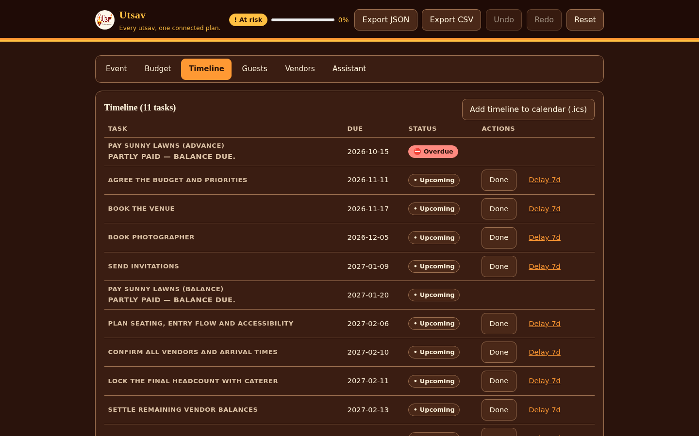
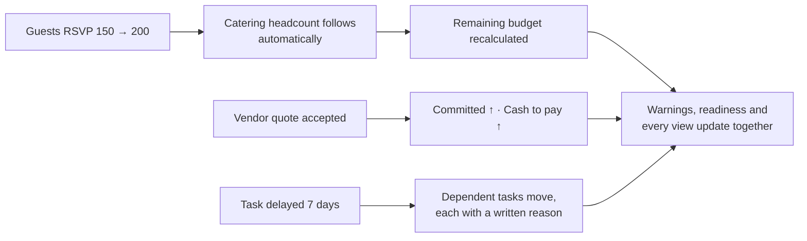
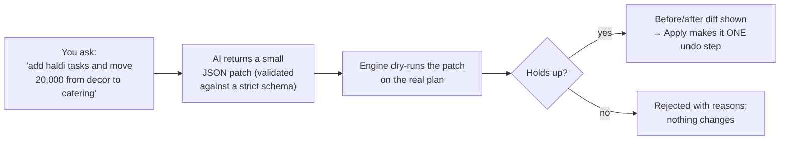
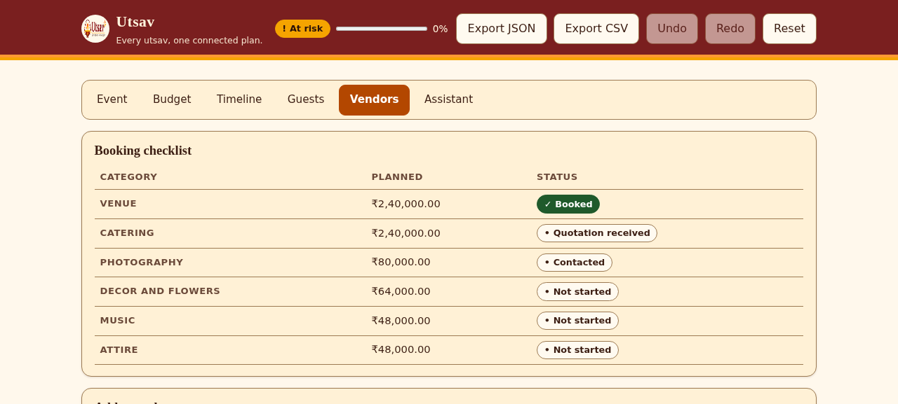
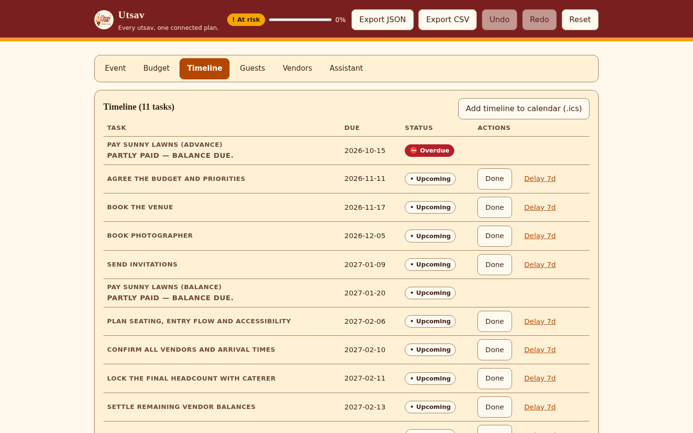
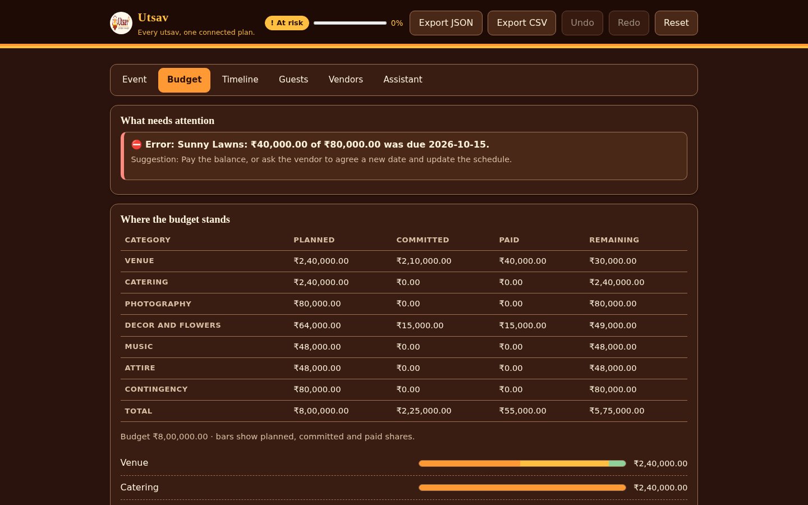
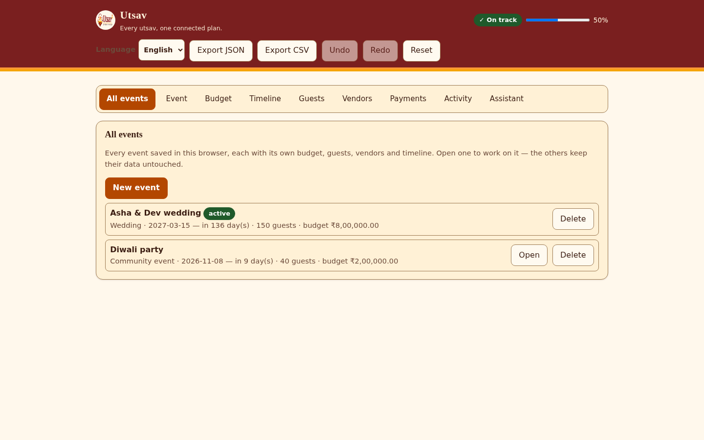
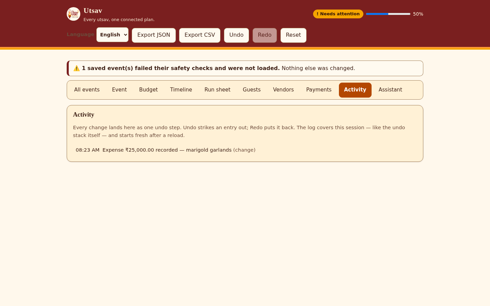
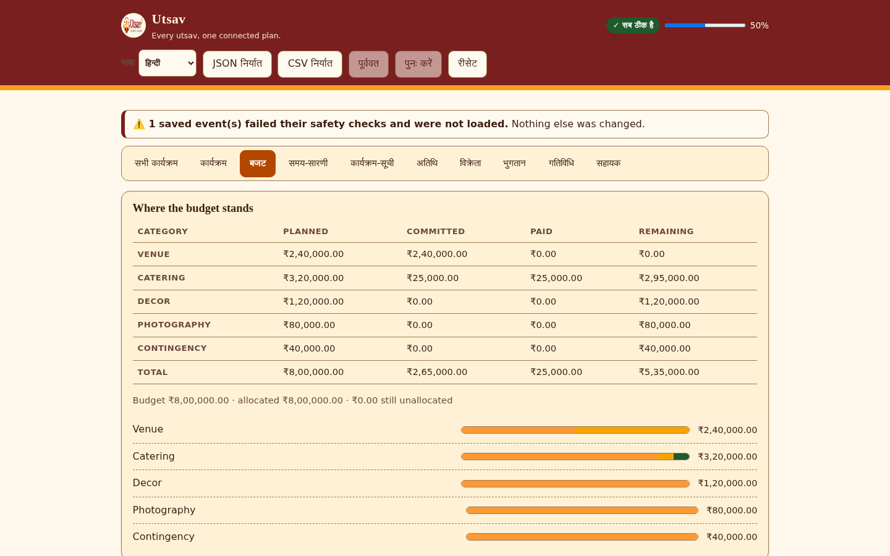

<p align="center"></p>

# Utsav · उत्सव

### Every utsav, one connected plan.

One plan for budget, timeline, guests, vendors and payments — where every change moves
everything else, instantly, in the browser. **The AI proposes; the engine disposes.**

[](https://github.com/RohitDeore96/Eventplanner/actions)


**[🌐 Live app — verified](https://eventplanner-mocha.vercel.app/)** · MIT license · built for PromptWars Virtual, Challenge 5: Celebration & Event Planner

---

<table>
<tr>
<td align="center"><b>1 plan</b><br/><sub>budget, timeline, guests, vendors and payments stay in sync</sub></td>
<td align="center"><b>4 occasions</b><br/><sub>wedding, kid's birthday, community festival, milestone celebration — each with its own presets</sub></td>
<td align="center"><b>6 guarded AI touchpoints</b><br/><sub>language only, never the maths</sub></td>
<td align="center"><b>1 engine</b><br/><sub>pure TypeScript; the AI can't touch a single rupee</sub></td>
</tr>
</table>

<p align="center">
  
  
</p>
<p align="center">
  <sub><b>Budget</b> (light) and <b>Timeline</b> (dark): one plan, two views, numbers that always reconcile — every other screen is in <a href="#-screenshots">Screenshots</a>.</sub>
</p>

**Jump to:** [The problem](#-the-problem) · [The idea](#-the-idea-one-plan-everything-connected) · [The design rule](#%EF%B8%8F-the-design-rule-the-ai-proposes-the-engine-disposes) · [Try it](#%EF%B8%8F-try-it-in-two-minutes) · [Screenshots](#-screenshots) · [Features](#-what-it-does) · [Architecture](#%EF%B8%8F-architecture) · [AI usage](#-ai-usage) · [What makes it different](#-what-makes-utsav-different) · [Quality](#-quality) · [Security](#-security) · [Run locally](#-run-it-locally) · [Deploy](#-deploy-on-vercel)

## 🤯 The problem

The budget lives in a notebook. The guest list lives on WhatsApp. The caterer's quote lives
in a voice note. The deadlines live in somebody's head. Then the guest list grows by 50, and
nobody can say what that does to the catering bill, the venue, or the date by which the
caterer must be told.

Event planning is not one problem. It is a set of **connected** problems:

- 👥 guest count drives catering and seating
- 💰 the budget drives every category
- 📅 the event date drives the whole timeline
- 🧾 every vendor quote and payment changes what is committed, what is paid and what is left

Spreadsheets and chat threads do not move together. Utsav does.

## 💡 The idea: one plan, everything connected

Utsav keeps a **single plan object** reduced by **one pure engine**. Any change — guests,
budget, date, a vendor quote, a payment, a delayed task — re-runs the engine and every view,
warning and readiness figure updates from the same numbers. There is no second place where
the truth could live, so the totals can never disagree.



The engine is deterministic, integer-only, and has no clock and no network: `today` is
passed in, so tests can prove behaviour on any date. Money is stored as integer minor units
(JavaScript numbers, always inside the safe range); BigInt handles the intermediate
arithmetic where exact products could overflow. Nothing divides by a hardcoded 100 — every
conversion goes through the currency's real exponent (JPY 0, INR 2, KWD 3).

## ⚖️ The design rule: the AI proposes, the engine disposes

Most AI planners let the model touch numbers directly. Utsav refuses. A deterministic engine
owns all money and all dates; the hosted LLM only does what needs language understanding —
and even its **changes** are treated as untrusted proposals:



- The patch is a list of engine actions, not free-form edits — the AI can only do what an
  action expresses, and `reducePlan` re-validates everything.
- **One money boundary.** The model never does exponent arithmetic: it states amounts as
  plain decimal strings in major units, exactly as a human writes them ("8 lakh" → `800000`,
  "KWD 100.125" → `100.125`), and the serverless route converts exactly once with the plan's
  currency (INR ×100, JPY ×1, KWD ×1000). Every `*Minor` field in the app, the storage and
  the exports is true minor units — ₹8,00,000 is always exactly 80,000,000 paise.
- Every AI reply is labelled with its source: the model that answered, or **"built-in"**.
- **With no API key the app stays fully usable**: every AI panel answers from a built-in
  deterministic planner and says so. Nothing is ever invented.

## ⏱️ Try it in two minutes

Open the **[live app](https://eventplanner-mocha.vercel.app/)**:

1. 🎬 Press **Load demo event** — "Asha & Dev", a full wedding with vendors, instalments,
   expenses, RSVPs and one overdue payment appears instantly, so every screen has real data.
2. 💰 **Budget.** Read _planned / committed / paid / remaining_ per category — they always
   reconcile. The warning card states the problem in words ("₹40,000 of ₹80,000 was due
   2026-10-15") **and** a suggested fix.
3. 📅 **Timeline.** Eleven dependency-ordered tasks. Press **Delay 7d** on _Book the venue_
   and watch downstream tasks move with reasons. **Add timeline to calendar (.ics)** puts
   every date and reminder on your phone.
4. 👥 **Guests.** Add guests one line at a time, flip RSVPs, set dietary preferences
   (vegetarian, vegan, jain and more) — and watch the catering headcount and dietary
   counts follow automatically.
5. 🧾 **Vendors.** Each vendor has a booking status and a payment schedule. Paste a quote
   and AI reads the fields — anything not stated stays empty and is flagged as a gap
   ("no cancellation policy") rather than guessed.
6. 🧭 **Assistant.** Ask _"Kitna kharcha bacha hai?"_, get occasion-tuned ideas, and — the
   differentiator — **ask AI to change the plan**: it proposes a patch, the engine dry-runs
   it, you see the exact before/after, and **Apply** makes it one undo step. Reject does
   nothing at all.
7. 🎪 **All events.** Create a second event, switch between them — each keeps its own
   budget, guests, vendors and timeline. Deleting asks twice.
8. 🔮 **Stress-test it.** On Budget, press **Run stress test**: guests +20%, vendor prices
   +10% and budget −15% hit at once, and the plan gets a plain survives-or-breaks verdict —
   nothing changes until you apply. **Payments** shows every scheduled payment by month;
   **Activity** lists every change as one undo step.
9. ↩️ **Undo everything.** Every change — yours or AI's — is one undo step. **Export
   JSON/CSV** gives you the real data, not a summary. And the header's language picker
   switches the chrome to हिन्दी or मराठी.

## 📸 Screenshots

Every tab of the live app — light and dark themes, desktop and phone. Captions say what
to look at; the numbers in one view are the same numbers every other view shows.

<p align="center">
  
</p>
<p align="center">
  <sub><b>Assistant</b> — a review grounded in the plan's own numbers, ask-the-planner in English or Hinglish,<br/>occasion-tuned ideas, and AI-suggested changes the engine checks before anything is applied.</sub>
</p>

<table>
  <tr>
    <td width="50%" align="center">
      <br/>
      <sub><b>Guests</b> — RSVP and dietary needs; the catering headcount follows automatically.</sub>
    </td>
    <td width="50%" align="center">
      <br/>
      <sub><b>Vendors</b> — booking checklist with per-category amounts and payment statuses.</sub>
    </td>
  </tr>
  <tr>
    <td width="50%" align="center">
      <br/>
      <sub><b>Timeline</b> — dependency-ordered tasks; <i>Delay 7d</i> ripples with written reasons.</sub>
    </td>
    <td width="50%" align="center">
      <br/>
      <sub><b>Budget (dark)</b> — the same reconciled numbers in the designed dark theme.</sub>
    </td>
  </tr>
  <tr>
    <td width="50%" align="center">
      <br/>
      <sub><b>Payments</b> — the cash-flow calendar: which month carries which payment,<br/>what is settled, what is still to pay, overdue first.</sub>
    </td>
    <td width="50%" align="center">
      <br/>
      <sub><b>All events</b> — a workspace of events, each with its own budget, guests,<br/>vendors and timeline; switch in one click, delete with confirmation.</sub>
    </td>
  </tr>
  <tr>
    <td width="50%" align="center">
      <br/>
      <sub><b>Stress test</b> — all three shocks at once on a copy of the plan;<br/>a plain verdict says whether the wedding survives.</sub>
    </td>
    <td width="50%" align="center">
      <br/>
      <sub><b>Activity</b> — every change as one readable line, the same steps<br/>Undo walks back through; undone entries struck out.</sub>
    </td>
  </tr>
  <tr>
    <td width="50%" align="center">
      <br/>
      <sub><b>Run sheet</b> — the event day itself, hour by hour: owners, places,<br/>conflicts flagged for review, and a print button that prints only the schedule.</sub>
    </td>
    <td width="50%" align="center">
      <br/>
      <sub><b>Quotations</b> — saved quotes with a review → shortlist → accept lifecycle;<br/>accepting books the vendor through the engine and can never happen twice.</sub>
    </td>
  </tr>
  <tr>
    <td width="50%" align="center">
      <br/>
      <sub><b>हिन्दी / मराठी</b> — the chrome speaks the family's language;<br/>the choice persists, and screen readers follow via <code>lang</code>.</sub>
    </td>
    <td width="50%" align="center">
      <br/>
      <sub><b>On a phone</b> — the same plan in a single column,<br/>44 px touch targets, AA contrast in both themes.</sub>
    </td>
  </tr>
</table>

## ✨ What it does

| You need to                    | Utsav gives you                                                                                                                                                                                                                                            |
| ------------------------------ | ---------------------------------------------------------------------------------------------------------------------------------------------------------------------------------------------------------------------------------------------------------- |
| 💰 Keep spending in check      | Occasion presets, per-category planned/committed/paid/remaining that always reconcile, an **allocation editor with category locks**, unallocated/over-allocated at a glance, and a **trade-off planner** that funds a category without breaking the budget |
| 🧾 Pay vendors in instalments  | Full vendor records (contact person, phone, email, notes), schedules per vendor with references, record payments against each instalment — partial payments, balances and overdue flags straight from the real ledger, plus payment history per vendor     |
| 📅 Never miss a deadline       | Dependency-aware timeline with overdue and impossible flags, delay propagation with written reasons, **calendar export (.ics)**                                                                                                                            |
| 👥 Survive a bigger guest list | RSVP tracking (confirmed/declined) with dietary needs feeding the catering headcount automatically                                                                                                                                                         |
| 👥 Manage dietary needs        | Ten dietary tags per guest, inline editing, search and RSVP/group filters, allergy alerts written in words (never colour alone)                                                                                                                            |
| 🧾 Read vendor quotes          | AI quote extraction with **honest gaps**: unstated fields stay empty and are flagged, never guessed                                                                                                                                                        |
| 📊 Compare quotations          | Save quotes per category with a **review → shortlist → accepted/rejected lifecycle**, correct every extracted field before saving, validity dates and notes, side-by-side comparison — accepting books the vendor and can never happen twice               |
| 🗓️ See when money leaves       | A **cash-flow calendar**: every scheduled payment in its due month with paid and still-to-pay columns, an overdue alert on top and per-month totals — driven by the same expense ledger                                                                    |
| 🎪 Plan more than one event    | A **multi-event workspace**: every event keeps its own everything; **duplicate** copies a plan under fresh ids, **archive/restore** sets events aside without deleting, delete needs a real confirmation — migrated from older single-plan saves           |
| 📋 Know who to book            | A vendor checklist per occasion with statuses, and per-vendor payment tracking                                                                                                                                                                             |
| 💡 Get fresh ideas             | Ideas tuned to **saved per-event preferences** (style, formality, budget tier, must-haves) plus remaining budget and booked vendors — **no prices, ever**                                                                                                  |
| 🔮 Stress-test the plan        | What-if scenarios (guests +20%, vendor +10%, budget −15%, venue/catering shocks, closer date) previewed on a copy — plus a **full stress test** that fires the three biggest shocks at once and says plainly whether the plan survives or breaks           |
| 🧭 Ask about your plan         | A planner that answers in English or Hinglish, grounded in the plan's own facts, with a built-in fallback when AI is down                                                                                                                                  |
| 🤖 Change plans by sentence    | Free-text → AI patch → engine dry-run → before/after → approve as one undo step (or reject, changing nothing)                                                                                                                                              |
| ↩️ Change your mind            | Undo/redo for every accepted change, an **activity log** that reads like the plan's history, **Load demo event**, Reset, JSON/CSV export                                                                                                                   |
| 🗣️ Feel at home                | The app chrome — tabs, header controls, readiness — speaks **English, हिन्दी or मराठी**, persisted per browser, with the document language following for screen readers                                                                                    |
| 🌙 Work anywhere               | Designed dark mode, 44 px touch targets, keyboard-operable throughout, WCAG 2.1 AA contrast enforced by test in both themes                                                                                                                                |

## ⚖️ How the work is split

|                                                          | Deterministic engine (`src/engine`) | Hosted LLM (`api/`, server only) |
| -------------------------------------------------------- | :---------------------------------: | :------------------------------: |
| Money: allocation, expenses, instalments, reconciliation |                 ✅                  |                                  |
| Scheduling, dependencies, delay ripple, .ics             |                 ✅                  |                                  |
| Guests, RSVPs, catering headcount                        |                 ✅                  |                                  |
| Warnings with plain-language fixes                       |                 ✅                  |                                  |
| Vetting AI patches (dry-run gate)                        |                 ✅                  |                                  |
| Built-in answers when AI is unavailable                  |                 ✅                  |                                  |
| Read a free-text event description                       |                                     |                ✅                |
| Read a pasted vendor quote                               |                                     |                ✅                |
| Ideas, plan review, answers grounded in plan facts       |                                     |                ✅                |
| Propose small patches (engine still gates them)          |                                     |                ✅                |

## 🏗️ Architecture


**One reducer** (`reducePlan`) handles every change — manual edits and accepted AI patches
alike — so undo treats an AI patch as one step. Engine functions return `Result<T>` with a
stable error code, a human message and the offending field; the reducer never throws on
arbitrary input (fuzz-tested).

| Module                     | Responsibility                                                                 |
| -------------------------- | ------------------------------------------------------------------------------ |
| `money.ts`                 | integer minor units, BigInt parsing, cached locale formatters                  |
| `budget.ts`                | allocation, expenses, instalments, committed vs paid                           |
| `tasks.ts` · `timeline.ts` | dependency graph, delay propagation, overdue/impossible flags                  |
| `guests.ts`                | RSVPs, dietary counts, catering headcount                                      |
| `vendors.ts`               | checklist statuses, payment schedules                                          |
| `patch.ts`                 | dry-run gate: validate an AI patch against the real plan before anyone sees it |
| `ics.ts`                   | RFC 5545 calendar export with escaping and reminders                           |
| `scenario.ts`              | what-if comparisons without touching the live plan                             |
| `history.ts`               | undo/redo as first-class engine state                                          |
| `summary.ts`               | readiness, totals, warning roll-up                                             |

## 🤖 AI usage

- **Server only.** The API key is read inside serverless functions, never in the browser,
  the repo or the logs. The browser talks only to same-origin `/api/*` routes.
- **JSON mode with a response schema** derived from the same zod schemas the app uses; the
  reply is validated on the server (`502 AI_RESPONSE_INVALID` on failure) and again on the
  client. Raw model text never reaches the UI.
- **Model chain with automatic failover.** A configurable list of the provider's current
  models (overridable via environment), newest documented first; if one is overloaded or
  retired, the next answers. The UI never shows the shuffle — each reply simply labels who
  answered.
- **Guarded routes.** POST-only (405), same-origin only (403), JSON-only (415), 8 KB body
  cap (413), schema validation (400), per-IP rate limit 20/5 min (429), 15 s timeout (504),
  a daily global AI cap (429), and safe error codes only — never a stack trace.
- **Prompt-injection guard.** User text is wrapped in data tags with closing-tag tricks
  stripped; the model is told user text is data, never instructions; it may never invent
  prices, vendors or availability; unknown fields stay `null`.
- **Cache.** Identical validated requests within 10 minutes are served from an in-memory
  cache, so repeats cost nothing.
- **Fallbacks first.** AI down or no key → every panel degrades to the built-in planner and
  labels the answer "built-in". Budget, timeline, guests, vendors and export never depend
  on AI at all.
- **Plain transport.** The AI layer is a thin `fetch` call to the provider's JSON-mode REST
  endpoint — no heavy SDK in the serverless bundle, tiny cold starts, nothing to trace.

## 🏆 What makes Utsav different

Many planners bolt a chatbot onto a form. Utsav is built the other way round: a
deterministic planning engine first, language models only at the edges — and every edge is
guarded, labelled and reversible.

- **One plan, everything connected.** Budget, timeline, guests, vendors and payments are
  one state reduced by one pure engine — the totals can never disagree with each other.
- **The AI proposes; the engine disposes.** Free-text → JSON patch → schema validation →
  engine dry-run → before/after preview → apply as **one undo step**. The AI cannot touch a
  single rupee or date directly, and a rejected proposal changes nothing.
- **Honest AI, with or without a key.** Every AI reply carries its source label; with no
  API key configured the app stays fully usable through deterministic built-in answers —
  it never pretends a fallback came from a model, and it never invents numbers.
- **Vendor money is first-class.** Instalment schedules, partial payments, one-minor-unit
  settlement, cash-to-pay totals, "partly paid — balance due" flags and overdue detection —
  all through the same ledger, never a separate paid flag that can disagree with expenses.
- **Guests drive the food.** RSVPs, plus-ones and dietary needs (vegetarian, vegan, jain,
  halal and more) feed the catering headcount automatically.
- **Everything reverses.** Manual edit or accepted AI patch — every change is one undo
  step, persisted across reloads.
- **See it before you build it.** A one-click demo event — a full wedding with vendors,
  instalments, expenses, RSVPs and an overdue payment — populates every screen instantly.
- **Proof over promises.** 635 automated unit/integration tests plus 77 real-browser
  Playwright journey runs (21 journeys × desktop and mobile profiles, on the production
  build), enforced coverage gates, generated metrics, a strict CSP, and honest "not done
  yet" notes throughout the docs.

## ✅ Quality

**For evaluators:** the evidence trail is indexed in
[docs/PHASE3_EVIDENCE_INDEX.md](docs/PHASE3_EVIDENCE_INDEX.md) — problem-alignment matrix,
functional-completeness matrix, accessibility report, 24-scenario AI evaluation, the full
test report and a repeatable 15-minute demo ([docs/DEMO.md](docs/DEMO.md)). The final
audit is [docs/PHASE3_FINAL_AUDIT.md](docs/PHASE3_FINAL_AUDIT.md).

### Code quality

- TypeScript `strict` with `noUncheckedIndexedAccess`; no `any`, no `@ts-ignore`.
- ESLint **typescript-eslint strictTypeChecked** with zero findings; Prettier enforced.
- Business logic only in `src/engine` as pure functions; components render and dispatch;
  API handlers are thin (guard → validate → call → validate → respond).
- `dependency-cruiser` enforces the layering (UI → engine, no cycles, no orphans); `knip`
  fails on unused files and exports.
- Every new dependency needs a one-line justification in [docs/DECISIONS.md](docs/DECISIONS.md).

### Testing: 635 automated tests + 77 real-browser journey runs

`npm run check` = format + lint + types + architecture + unused code + tests with enforced
coverage thresholds (95% lines / 94% statements / 94% functions / 83% branches — a ratchet
that may only move up). **Playwright E2E** (`npm run test:e2e`) runs the production build in
real Chromium — desktop and mobile — through the core journeys: `8,00,000` and `8.5 lakh`
storing as exactly 80,000,000 / 85,000,000 minor units, JPY/KWD/USD exponent plans, the full
autosave lifecycle (modify → reload → undo → reload), currency-lock protection, corrupt- and
legacy-storage recovery and migration, vendor payments surviving reloads, dietary needs,
AI-patch reject/apply/undo, honest offline-AI fallbacks, a zero-console-error walk — and a
differentiators journey that creates a second event, switches and deletes it, runs the full
stress test, walks the payments calendar and activity log, and flips the chrome to Hindi and
Marathi (partly keyboard-driven). AI
endpoints are mocked for determinism; an opt-in live smoke test (`npm run smoke:ai`) checks
the real provider against every response schema when a key is configured.

- **Engine**: unit tests per module, snapshot tests for occasion presets, and **property
  tests with fast-check**: arbitrary JSON as an action never throws, category totals always
  sum exactly to the budget, schedules never contain cycles.
- **API routes**: the real handlers with a mocked AI endpoint — 405/403/415/400/413/429/503/
  502 paths, cache-hit proof, input-sensitivity proof, model-chain failover proof, and the
  no-key fallback path as a first-class test.
- **UI**: component tests for every view, the AI patch flow (dry-run → apply → undo),
  persistence with schema migration, the demo event, and **axe accessibility scans** plus
  **token-level WCAG contrast math in both themes**.
- **Mutation testing** is configured (`npm run mutation`) as a scheduled job: it measures
  whether the tests actually catch bugs, not just whether they pass.
- `docs/METRICS.md` is **generated from real runs** (`node scripts/gen-metrics.mjs`) —
  nothing there is typed by hand, and every check it reports is one of the gates CI runs.

### ♿ Accessibility (WCAG 2.2 AA as the engineering target)

Skip link, landmarks, labelled inputs, error alerts wired to fields, visible focus rings,
44 px touch targets, `aria-live` for statuses and AI results, status always **text + icon
(never colour alone)**, tables with `th scope`, labelled progress bars, light/dark token
contrast enforced by test, `prefers-reduced-motion` / `prefers-contrast` / forced-colours
support. Phase 3 added **browser-level evidence**: axe-core scans of every view in light
AND dark themes (0 serious/critical), a dedicated keyboard-only journey (skip link, form
completion, arrow-key tabs, no traps, visible focus, keyboard-operable destructive
confirm), a 320 px reflow scan, and a reduced-motion check — all in
[e2e/specs/accessibility.spec.ts](e2e/specs/accessibility.spec.ts), reported in
[docs/ACCESSIBILITY_REPORT.md](docs/ACCESSIBILITY_REPORT.md) with machine-readable
results and screenshots in `e2e/evidence/accessibility/`. **Not yet tested with real
screen readers** — stated honestly.

## 🔒 Security

| Area         | What Utsav does                                                                                                                                                                                                                                                                                                                                                       |
| ------------ | --------------------------------------------------------------------------------------------------------------------------------------------------------------------------------------------------------------------------------------------------------------------------------------------------------------------------------------------------------------------- |
| Secrets      | API key only inside serverless functions; `.env` gitignored; `.env.example` has placeholders; secret scan in the repo (`scripts/secret-scan.mjs`)                                                                                                                                                                                                                     |
| Input        | zod validation on every endpoint and on every AI reply; 8 KB body cap; oversized/invalid → 400/413                                                                                                                                                                                                                                                                    |
| Abuse        | POST only, JSON only, **same-origin only** (403 otherwise — other sites cannot spend the AI quota), per-IP rate limit (20/5 min), daily global AI cap                                                                                                                                                                                                                 |
| Output       | Schema-validated before returning; errors carry a code only, never a stack trace or user text                                                                                                                                                                                                                                                                         |
| Browser      | Strict CSP **without `unsafe-inline`**, HSTS (2 years, preload), `frame-ancestors 'none'`, nosniff, COOP, referrer + permissions policy (`vercel.json`)                                                                                                                                                                                                               |
| Persistence  | Saved plans are untrusted: size cap → deep zod schema (every nested record) → duplicate-id, currency, calendar-date and cross-vendor checks → `schemaVersion` migration; unusable data never reaches the app and is never silently deleted — a recovery notice offers an exportable copy and a fresh start; the reducer never throws on arbitrary input (fuzz-tested) |
| Supply chain | `npm audit` clean at high severity for runtime deps, lockfile committed, CI uses `npm ci`                                                                                                                                                                                                                                                                             |

Residual risks and the full threat model: [SECURITY.md](SECURITY.md).

## 🆘 Honest limits

- The rate limiter and daily AI cap are **per serverless instance** (no shared store yet).
- Accessibility is tested with axe in jsdom and token math — not yet with real screen readers.
- The quote reader depends on what the pasted text says; unstated fields stay empty on purpose.
- Share links are not built. Scenario comparison and the full stress test are in the UI
  (Budget → What-if scenarios); a one-file event summary export (budget, vendor payment
  states, dietary aggregates, run sheet, warnings) is in the header — "Event summary".
- The keyboard-only walk is now a dedicated Playwright journey (accessibility.spec.ts);
  what remains open is a pass with an actual screen reader (NVDA/VoiceOver).
- Hindi/Marathi covers the app chrome (tabs, header controls, readiness, skip link);
  forms and per-view copy stay English for now — a missing label falls back to English,
  never to an empty string.
- Live AI answers are not exercised by CI (no key in the pipeline); `npm run smoke:ai` is the
  opt-in live check. Until the AI provider key is configured in the Vercel dashboard (variable names in
  `.env.example`), the live AI panels answer from the built-in planner — which is itself
  worth trying, because it is the honesty path.

## 🇮🇳 Assumptions (all editable in the app)

- Occasion splits (wedding: venue 30%, catering 30%, photography 10%, decor 8%, music 6%,
  attire 6%, contingency 10%) are documented starting points, not market data.
- A scheduled payment settles only when summed payments reach its amount; partial and
  multiple payments are supported; overpaying warns instead of hiding.
- Money display follows each currency's real exponent and the selected locale; currency is
  switchable (INR, USD, EUR, GBP, AED, JPY, KWD) and the whole plan re-formats. A plan's
  currency is locked once vendor agreements or payments exist — switching would silently
  reinterpret every amount.
- AI intake and quote readings are suggestions to verify — every reply says where it came from.

## 🚀 Run it locally

```bash
git clone https://github.com/RohitDeore96/Eventplanner.git
cd Eventplanner
npm install
cp .env.example .env    # optional: add the AI provider key (variable names in .env.example)
npm run api             # terminal 1: the same handlers Vercel runs, on :8787
npm run dev             # terminal 2: the app on :5173 (proxies /api)
```

| Command                        | What it does                                                                 |
| ------------------------------ | ---------------------------------------------------------------------------- |
| `npm run check`                | format, lint, types, architecture rules, unused code, tests + coverage gates |
| `npm test`                     | the whole suite                                                              |
| `npm run build`                | production build                                                             |
| `node scripts/gen-metrics.mjs` | regenerate `docs/METRICS.md` from real runs                                  |
| `node scripts/secret-scan.mjs` | scan the repo for accidental secrets                                         |
| `npm run test:e2e`             | Playwright: real-browser journeys (desktop + mobile) on the production build |
| `npm run mutation`             | Stryker mutation testing (slow; scheduled job)                               |

Environment (all optional, exact names in `.env.example`): the AI provider key — the app is
fully usable without it — a model-chain override, and a daily AI cap.

## ☁️ Deploy on Vercel

1. Push this repo to GitHub, then **Vercel → Add New → Project → Import** the repo.
2. Vercel auto-detects Vite (`vercel.json` pins the settings). Deploy.
3. **Settings → Environment Variables → add the AI provider key**, named exactly as in
   `.env.example` (get it from your AI provider's console), then redeploy — that is the
   only step that turns on the AI features.
4. Every push to `main` redeploys automatically. Security headers come from `vercel.json`;
   the six serverless functions in `api/` are picked up automatically.

More detail in [docs/AUDIT.md](docs/AUDIT.md) (defects found and fixed) ·
[docs/ARCHITECTURE.md](docs/ARCHITECTURE.md) · [docs/SPEC.md](docs/SPEC.md) ·
[docs/DECISIONS.md](docs/DECISIONS.md) · [docs/METRICS.md](docs/METRICS.md) (generated) ·
[SECURITY.md](SECURITY.md)

## 📄 License

MIT © Rohit Deore
