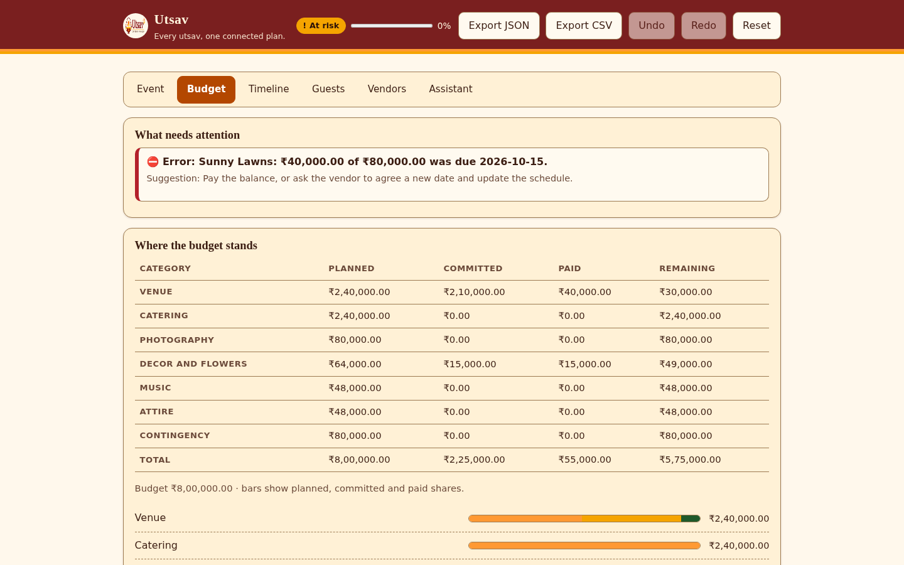
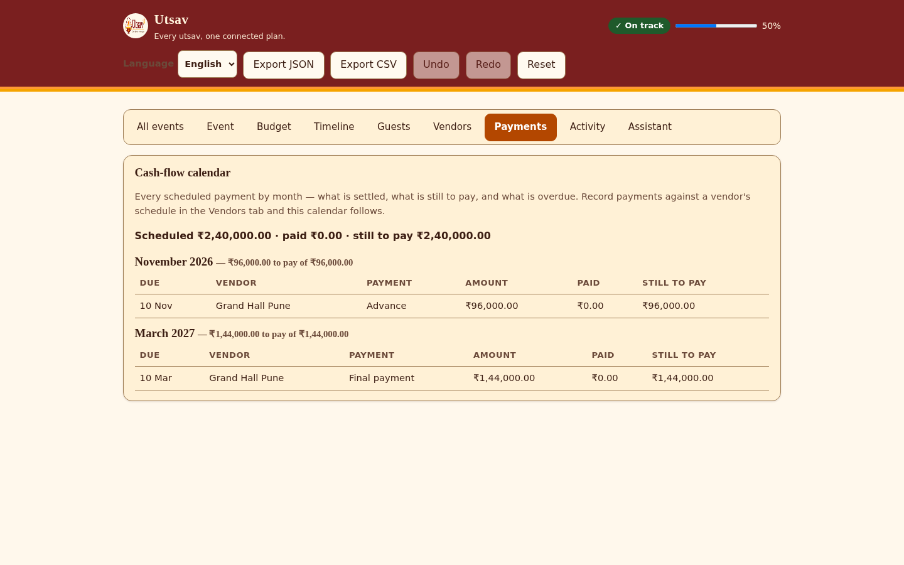
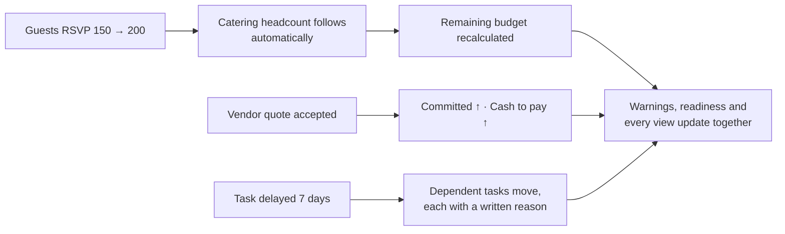
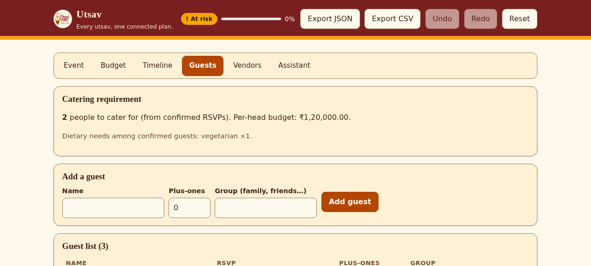
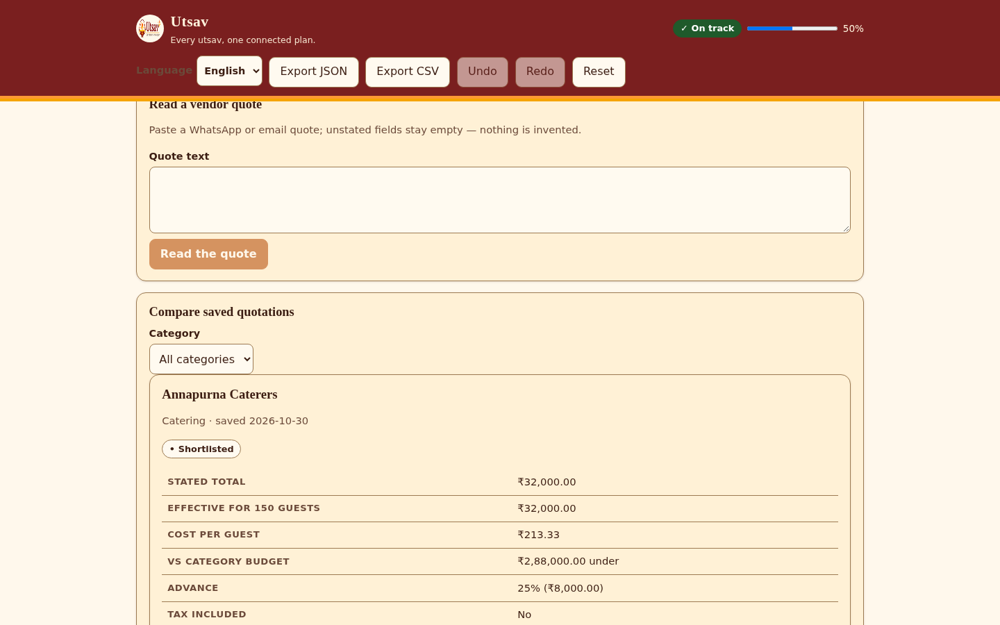
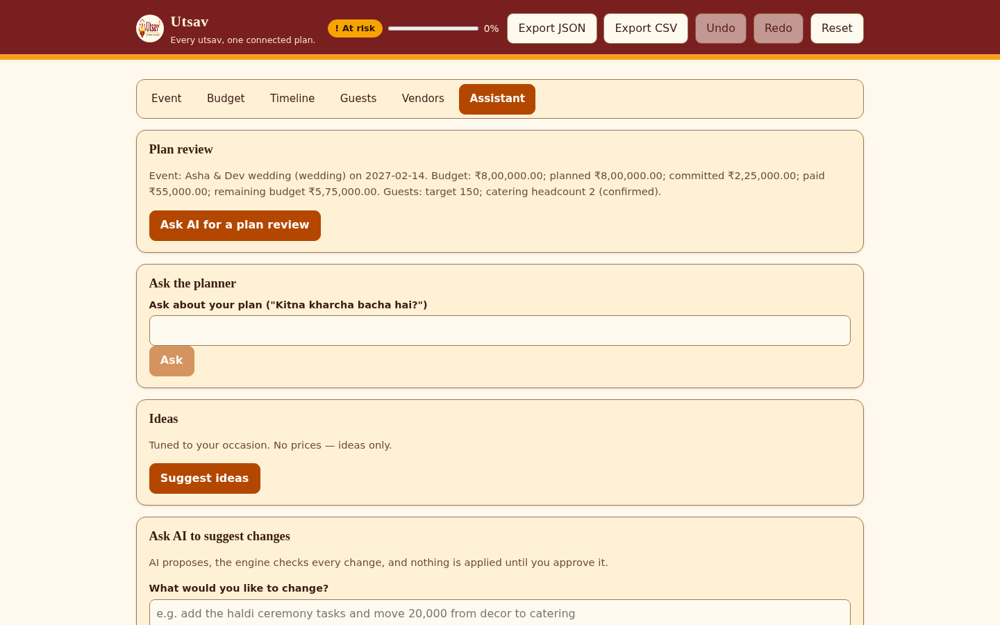
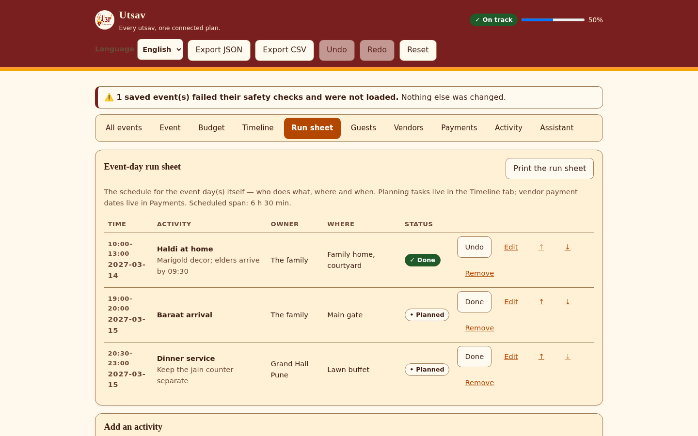
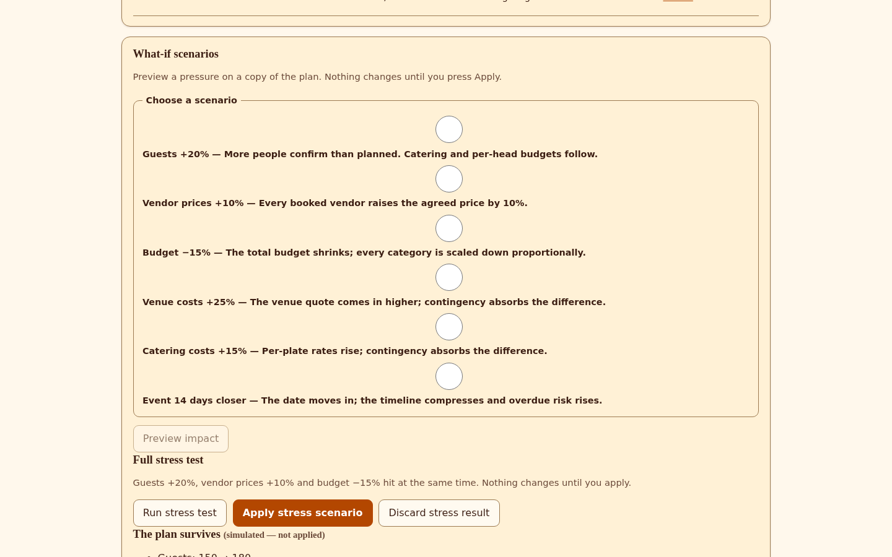
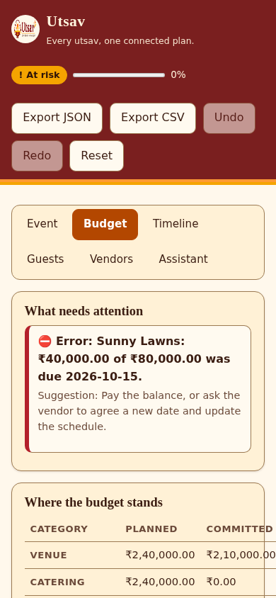
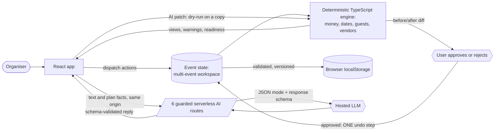

<p align="center"></p>

# Utsav · उत्सव

### Every utsav, one connected plan.

Utsav is an AI-assisted event planner that connects budgets, guests, vendors, payments, quotations and schedules into one validated planning system.

**The AI proposes. The engine validates. The user decides.**

**[Open the live app](https://eventplanner-mocha.vercel.app/)** · [Evaluator quick start (about 3 minutes)](#evaluator-quick-start) · [Full demo script](docs/DEMO.md) · [Evidence index](docs/PHASE3_EVIDENCE_INDEX.md)

Built for PromptWars Virtual, Challenge 5: Celebration & Event Planner · React 18 · TypeScript (strict) · Vite · zod · Vercel serverless functions · AI · MIT licence

[](https://github.com/RohitDeore96/Eventplanner/actions)


> **Recorded verification, 2026-10-31** (generated by `node scripts/gen-metrics.mjs`, see [docs/METRICS.md](docs/METRICS.md)). These are the results of one recorded run on that date, not a live status: 665 unit/integration tests across 57 files · 77 browser tests passed and 1 skipped by design · 96.18% line / 94.29% statement / 96.61% function / 83.67% branch coverage · 115.2 KB gzipped JavaScript · zero serious or critical axe violations in the recorded scans ([accessibility report](docs/ACCESSIBILITY_REPORT.md)).

<p align="center">
  
  
</p>

**Jump to:** [The problem](#the-problem) · [How Utsav solves it](#how-utsav-solves-it) · [How to verify Utsav](#how-to-verify-utsav) · [Evaluator quick start](#evaluator-quick-start) · [What makes it different](#what-makes-utsav-different) · [Features and outcomes](#features-and-user-outcomes) · [Screenshots](#screenshots) · [Architecture](#architecture) · [AI design and safety](#ai-design-and-safety) · [Quality and evidence](#quality-and-evidence) · [Accessibility](#accessibility) · [Security](#security) · [Limitations](#limitations) · [Run locally](#run-it-locally) · [Deploy](#deploy-on-vercel)

## The problem

The budget lives in a notebook. The guest list lives on WhatsApp. The caterer's quote lives in a voice note. The deadlines live in somebody's head. Then the guest list grows by 50, and nobody can say what that does to the catering bill, the venue, or the date by which the caterer must be told.

Event planning is not one problem. It is a set of **connected** decisions:

- Guest count drives catering and seating.
- The budget drives every category.
- Vendor quotations change what is committed.
- Payment schedules change what is still owed, and when.
- The event date drives every task deadline.
- RSVPs and dietary needs drive the catering requirement.

Spreadsheets and chat threads do not move together, so each change has to be re-worked by hand and the totals drift apart. Utsav is built so they cannot.

## How Utsav solves it

Utsav keeps a **single plan object** per event, reduced by **one pure engine**. Any change (guests, budget, date, a vendor quote, a payment, a delayed task) re-runs the engine, and every view, warning and readiness figure updates from the same numbers. There is no second place where the truth could live, so the totals cannot disagree.



The engine is deterministic, integer-only, and has no clock and no network: `today` is passed in, so tests can prove behaviour on any date. Money is stored as integer minor units, and every conversion goes through the currency's real exponent (JPY 0, INR 2, KWD 3). Supported currencies: INR, USD, EUR, GBP, AED, JPY, KWD. Supported occasions: wedding, birthday, community festival, milestone celebration, each with its own presets.

## How to verify Utsav

| Question                                   | Where the answer is                                                                                                                                                                    |
| ------------------------------------------ | -------------------------------------------------------------------------------------------------------------------------------------------------------------------------------------- |
| Does it match the challenge?               | [Problem alignment](docs/PHASE3_PROBLEM_ALIGNMENT.md): R1–R10 with implementation and evidence                                                                                         |
| Is every workflow complete?                | [Functional completeness](docs/PHASE3_FUNCTIONAL_COMPLETENESS.md)                                                                                                                      |
| Is the AI useful, and how is it evaluated? | [AI evaluation](docs/AI_EVALUATION.md): 24 mocked-fixture scenarios, with the live-model status stated                                                                                 |
| Is it accessible?                          | [Accessibility report](docs/ACCESSIBILITY_REPORT.md): axe per view and theme, keyboard journey, reflow, and the screen-reader limitation                                               |
| Is it reliable?                            | [Test report](docs/PHASE3_TEST_REPORT.md) and [metrics](docs/METRICS.md)                                                                                                               |
| Where is everything?                       | [Evidence index](docs/PHASE3_EVIDENCE_INDEX.md), with a recommended reading order                                                                                                      |
| What are the remaining risks?              | [Final audit](docs/PHASE3_FINAL_AUDIT.md) and [documentation audit](docs/FINAL_DOCUMENTATION_AUDIT.md), which lists which claims are verified and which are not independently verified |

## Evaluator quick start

No API key is needed to explore the product. Open the **[live app](https://eventplanner-mocha.vercel.app/)** and follow these steps; [docs/DEMO.md](docs/DEMO.md) has the full 14-step lifecycle.

1. **Load the demo.** Press **Load demo event**. "Asha & Dev", a full wedding with vendors, instalments, expenses, RSVPs and one overdue payment, appears so every screen has real data.
2. **Budget.** Read planned, committed, paid and remaining per category. They always reconcile, and the warning card states the problem in words with a suggested fix.
3. **Vendors and Payments.** Open Vendors to see each vendor's booking status and payment schedule, then Payments for the cash-flow calendar grouped by due month.
4. **Quotations.** In Vendors, use _Capture a quotation_ and paste the sample text from [DEMO step 4](docs/DEMO.md). Unstated fields stay empty and are flagged. Save two quotes, compare them, shortlist and accept: accepting books the vendor and cannot happen twice.
5. **Guests.** Flip RSVPs, add a plus-one and set dietary tags. The catering headcount and dietary counts follow.
6. **Assistant.** Ask a question, then use _What would you like to change?_ Every reply carries a source label (a model name or "built-in"). A proposed change shows an exact before/after; **Apply** is one undo step and **Reject** changes nothing.
7. **Run sheet.** Add two overlapping activities ([DEMO step 12](docs/DEMO.md)) to see the conflict flag. Conflicts are flagged for you to fix, never auto-moved.
8. **Scenarios.** On Budget, open _What-if scenarios_ and press **Run stress test**. Compare the survives-or-breaks verdict, then apply or leave it untouched.
9. **All events.** Create a second event and switch between them. Each keeps its own budget, guests, vendors and timeline.

**What needs a provider key and what does not.** The six AI panels (intake, ideas, plan review, ask-the-planner, quotation extraction, change proposals) call a hosted model only when the deployment has a server-side key. Without one, each panel answers from a built-in deterministic planner and says so. Budget, timeline, guests, vendors, payments, run sheet, scenarios, undo and export never depend on AI. The deployment owner reports a manual live-AI check on 2026-10-31; no run log from it is committed, so treat live-model behaviour as owner-reported rather than independently evidenced. The source label on each reply tells you which path answered.

## What makes Utsav different

**One connected planning engine.** Financial, guest, vendor, payment and scheduling information is derived from the same event state, reduced by one pure engine. Paid state comes from the expense ledger, never from a separate flag that could disagree.

**AI with deterministic safeguards.** The AI proposes and explains. The engine validates every proposal on a copy of the plan, the user sees the exact before/after, and nothing changes without approval. The AI never touches money or dates directly.

**Evidence-driven engineering.** Financial property tests, browser journeys on the production build, accessibility scans, and AI contract evaluations support the implementation, and the limits of that evidence are stated alongside it.

## Features and user outcomes

| Real user problem            | What Utsav does                                                                                                          | Why it matters                               |
| ---------------------------- | ------------------------------------------------------------------------------------------------------------------------ | -------------------------------------------- |
| Budget uncertainty           | Planned, committed, paid and remaining per category, an allocation editor with category locks, and a trade-off planner   | Understand financial obligations at a glance |
| Vendor complexity            | Vendor records, booking status, instalment schedules, partial payments, overdue flags and a cash-flow calendar           | Track bookings and what is owed, and when    |
| Quotation confusion          | Capture a pasted quote, correct each field, save, compare side by side, and accept (review → shortlist → accepted)       | Make informed vendor choices                 |
| Changing guest counts        | RSVPs, plus-ones, ten dietary tags and allergy alerts feeding the catering headcount                                     | Keep catering information current            |
| Missed deadlines             | Dependency-aware timeline with overdue and impossible flags, delay ripple with written reasons, and .ics calendar export | Identify late and dependent work             |
| Event-day confusion          | Run sheet with owners, places, overlap and double-booking conflicts, and a print layout                                  | Clarify who does what, and when              |
| Uncertain planning decisions | What-if scenarios and a full stress test, previewed on a copy of the plan                                                | See consequences before committing           |
| Difficult planning changes   | Free-text change proposals, validated by the engine, with a before/after preview and approval                            | Review changes before applying them          |
| Running several events       | Multi-event workspace with duplicate, archive/restore and confirmed delete                                               | Keep each event isolated                     |
| Changing your mind           | Undo/redo for every change, an activity log, and JSON, CSV, .ics and one-file event-summary export                       | Nothing is permanent, and the data is yours  |
| Family language              | App chrome in English, हिन्दी or मराठी (forms and per-view copy stay English)                                            | Navigate in the family's language            |

## Screenshots

Each screenshot is a real capture of the application (`scripts/capture-screenshots.mjs`), shown in the order of the evaluator quick start.

<table>
  <tr>
    <td width="50%" align="center">
      <br/>
      <sub><b>Budget</b>: the reconciled financial overview, with an overdue-payment warning stated in words and a suggested fix.</sub>
    </td>
    <td width="50%" align="center">
      <br/>
      <sub><b>Payments</b>: which month carries which vendor payment, what is settled, what is still to pay, and overdue first.</sub>
    </td>
  </tr>
  <tr>
    <td width="50%" align="center">
      <br/>
      <sub><b>Guests</b>: RSVP and dietary needs; the catering headcount follows automatically.</sub>
    </td>
    <td width="50%" align="center">
      <br/>
      <sub><b>Quotations</b>: saved quotes side by side with effective price, per-guest cost and a review → shortlist → accept lifecycle.</sub>
    </td>
  </tr>
  <tr>
    <td width="50%" align="center">
      <br/>
      <sub><b>Assistant</b>: a review grounded in the plan's own numbers, ask-the-planner, ideas, and proposed changes the engine checks before anything is applied.</sub>
    </td>
    <td width="50%" align="center">
      <br/>
      <sub><b>Run sheet</b>: the event day hour by hour, with owners, places, flagged conflicts, and a print layout that prints only the schedule.</sub>
    </td>
  </tr>
  <tr>
    <td width="50%" align="center">
      <br/>
      <sub><b>Scenarios</b>: the full stress test fires three shocks at once on a copy of the plan and states whether it survives or breaks.</sub>
    </td>
    <td width="50%" align="center">
      <br/>
      <sub><b>On a phone</b>: the same plan in a single column with large touch targets.</sub>
    </td>
  </tr>
</table>

More captures (timeline, all events, activity log, Hindi chrome, dark theme) are in [`docs/screenshots/`](docs/screenshots/).

## Architecture



The boundary is strict:

- Deterministic code owns financial arithmetic, dates and scheduling rules.
- AI handles language-based work: extraction, recommendations, summaries and proposals.
- AI output is schema-validated before it reaches the UI.
- A proposed change is dry-run against the engine on a copy of the plan, and the user approves or rejects it.

Details, module map and the current storage model (workspace v3) are in [docs/ARCHITECTURE.md](docs/ARCHITECTURE.md).

**One reducer** (`reducePlan`) handles every change — manual edits and accepted AI patches
alike — so undo treats an AI patch as one step. Engine functions return `Result<T>` with a
stable error code, a human message and the offending field; the reducer never throws on
arbitrary input (fuzz-tested).

| Module                     | Responsibility                                                                 |
| -------------------------- | ------------------------------------------------------------------------------ |
| `money.ts`                 | integer minor units, BigInt parsing, cached locale formatters                  |
| `budget.ts`                | allocation, expenses, instalments, committed vs paid                           |
| `tasks.ts` · `timeline.ts` | dependency graph, delay propagation, overdue/impossible flags                  |
| `guests.ts`                | RSVPs, dietary counts, catering headcount                                      |
| `vendors.ts`               | checklist statuses, payment schedules                                          |
| `patch.ts`                 | dry-run gate: validate an AI patch against the real plan before anyone sees it |
| `ics.ts`                   | RFC 5545 calendar export with escaping and reminders                           |
| `scenario.ts`              | what-if comparisons without touching the live plan                             |
| `history.ts`               | undo/redo as first-class engine state                                          |
| `summary.ts`               | readiness, totals, warning roll-up                                             |

## How the work is split

|                                                          | Deterministic engine (`src/engine`) | Hosted LLM (`api/`, server only) |
| -------------------------------------------------------- | :---------------------------------: | :------------------------------: |
| Money: allocation, expenses, instalments, reconciliation |                 ✅                  |                                  |
| Scheduling, dependencies, delay ripple, .ics             |                 ✅                  |                                  |
| Guests, RSVPs, catering headcount                        |                 ✅                  |                                  |
| Warnings with plain-language fixes                       |                 ✅                  |                                  |
| Vetting AI patches (dry-run gate)                        |                 ✅                  |                                  |
| Built-in answers when AI is unavailable                  |                 ✅                  |                                  |
| Read a free-text event description                       |                                     |                ✅                |
| Read a pasted vendor quote                               |                                     |                ✅                |
| Ideas, plan review, answers grounded in plan facts       |                                     |                ✅                |
| Propose small patches (engine still gates them)          |                                     |                ✅                |

## AI design and safety

Six AI capabilities exist in the code, one serverless route each in `api/`:

| Capability              | You provide                                             | AI returns                                                                         | How it is validated                                                                   | What you do next                                      |
| ----------------------- | ------------------------------------------------------- | ---------------------------------------------------------------------------------- | ------------------------------------------------------------------------------------- | ----------------------------------------------------- |
| Natural-language intake | A sentence such as "Shaadi in Pune, 150 guests, 8 lakh" | Occasion, guests, budget (decimal major units), date                               | zod schema; one deterministic money conversion; unknown fields stay `null`            | Review and edit the filled form, then create the plan |
| Personalised ideas      | Occasion, guests, saved preferences                     | Themes, activities, food styles, personal touches                                  | zod schema; remaining budget and booked vendors sent as context; no prices            | Use them as inspiration                               |
| Plan review             | The plan's own facts (no guest names or notes)          | A short summary and at most three next steps                                       | zod schema; grounded in `planFacts()`                                                 | Act on the suggestions                                |
| Ask-the-planner         | A question in English or Hinglish                       | An answer drawn only from the plan facts, or a pointer to where in the app to look | zod schema; unanswerable questions are declined                                       | Follow up in the relevant tab                         |
| Quotation extraction    | Pasted quote text                                       | Structured fields; anything unstated is `null` and flagged                         | zod schema; one deterministic money conversion; input wrapped against injection       | Correct each field, save, and compare                 |
| Proposed plan changes   | A sentence such as "add a haldi task the day before"    | A JSON patch of at most 10 allowed actions                                         | zod union schema, then an engine dry-run that blocks anything that would add an error | Review before/after; Apply (one undo step) or Reject  |

**Three kinds of AI evidence, kept separate:**

| Kind                            | What it is                                                                                                                            | What it proves                                                                                                                                                   |
| ------------------------------- | ------------------------------------------------------------------------------------------------------------------------------------- | ---------------------------------------------------------------------------------------------------------------------------------------------------------------- |
| Built-in deterministic fallback | The planner that answers when there is no key or the provider fails; replies are labelled "built-in"                                  | The product stays useful and honest without a model                                                                                                              |
| Mocked AI testing               | 24 scenarios and 74 checks against recorded fixtures, plus route tests with a scripted model ([AI evaluation](docs/AI_EVALUATION.md)) | Validation, conversion, grounding and refusal contracts hold; **not** live model quality                                                                         |
| Live model interaction          | The opt-in `npm run smoke:ai` against the real provider, which needs a server-side provider key                                       | Whether the provider accepts every response schema. The recorded audit did not run it; the owner reports a manual live check on 2026-10-31 with no committed log |

The AI cannot change the plan directly: every change goes through the engine's dry-run and the user's approval.

Safeguards in the AI layer:

- **Server only.** The API key is read inside serverless functions, never in the browser,
  the repo or the logs. The browser talks only to same-origin `/api/*` routes.
- **JSON mode with a response schema** derived from the same zod schemas the app uses; the
  reply is validated on the server (`502 AI_RESPONSE_INVALID` on failure) and again on the
  client. Raw model text never reaches the UI.
- **Model chain with automatic failover.** A configurable list of the provider's current
  models (overridable via environment), newest documented first; if one is overloaded or
  retired, the next answers. The UI never shows the shuffle — each reply simply labels who
  answered.
- **Guarded routes.** POST-only (405), same-origin only (403), JSON-only (415), 8 KB body
  cap (413), schema validation (400), per-IP rate limit 20/5 min (429), 15 s timeout (504),
  a daily global AI cap (429), and safe error codes only — never a stack trace.
- **Prompt-injection guard.** User text is wrapped in data tags with closing-tag tricks
  stripped; the model is told user text is data, never instructions; it may never invent
  prices, vendors or availability; unknown fields stay `null`.
- **Cache.** Identical validated requests within 10 minutes are served from an in-memory
  cache, so repeats cost nothing.
- **Fallbacks first.** AI down or no key → every panel degrades to the built-in planner and
  labels the answer "built-in". Budget, timeline, guests, vendors and export never depend
  on AI at all.
- **Plain transport.** The AI layer is a thin `fetch` call to the provider's JSON-mode REST
  endpoint — no heavy SDK in the serverless bundle, tiny cold starts, nothing to trace.

Full methodology and results: [docs/AI_EVALUATION.md](docs/AI_EVALUATION.md).

## Quality and evidence

The evidence trail is indexed, with a recommended reading order, in [docs/PHASE3_EVIDENCE_INDEX.md](docs/PHASE3_EVIDENCE_INDEX.md). Figures below come from the recorded run of 2026-10-31 and match [docs/METRICS.md](docs/METRICS.md), the [test report](docs/PHASE3_TEST_REPORT.md) and the machine-readable results.

| Evidence                   | Recorded result (2026-10-31)                                                                                            | Source                                                                                      |
| -------------------------- | ----------------------------------------------------------------------------------------------------------------------- | ------------------------------------------------------------------------------------------- |
| Unit and integration tests | 665 passed across 57 files                                                                                              | [docs/METRICS.md](docs/METRICS.md)                                                          |
| Coverage                   | 96.18% lines, 94.29% statements, 96.61% functions, 83.67% branches (gates: 95 / 94 / 94 / 83)                           | [docs/METRICS.md](docs/METRICS.md), `vitest.config.ts`                                      |
| Browser tests (Playwright) | 77 passed, 0 failed, 1 skipped by design (39 tests × desktop and mobile profiles; the tablet spec runs on desktop only) | [e2e/evidence/e2e-results.json](e2e/evidence/e2e-results.json)                              |
| Accessibility scans        | 0 serious or critical axe violations in the recorded scans: 8 views × 2 themes plus setup and events × 2 themes         | [docs/ACCESSIBILITY_REPORT.md](docs/ACCESSIBILITY_REPORT.md), `e2e/evidence/accessibility/` |
| AI evaluation (mocked)     | 24 scenarios, 74 checks, 0 failed                                                                                       | [docs/evidence/ai/ai-eval-results.json](docs/evidence/ai/ai-eval-results.json)              |
| Bundle and repository size | 115.2 KB gzipped JavaScript (budget 250 KB); 1.58 MB repository (limit 10 MB)                                           | [docs/METRICS.md](docs/METRICS.md)                                                          |

### Code quality

- TypeScript `strict` with `noUncheckedIndexedAccess`; no `any`, no `@ts-ignore`.
- ESLint **typescript-eslint strictTypeChecked** with zero findings; Prettier enforced.
- Business logic only in `src/engine` as pure functions; components render and dispatch;
  API handlers are thin (guard → validate → call → validate → respond).
- `dependency-cruiser` enforces the layering (UI → engine, no cycles, no orphans); `knip`
  fails on unused files and exports.
- Every new dependency needs a one-line justification in [docs/DECISIONS.md](docs/DECISIONS.md).

### Testing: 665 unit/integration tests and 77 browser tests passed

`npm run check` = format + lint + types + architecture + unused code + tests with enforced
coverage thresholds (95% lines / 94% statements / 94% functions / 83% branches — a ratchet
that may only move up). **Playwright E2E** (`npm run test:e2e`) runs the production build in
real Chromium — desktop and mobile — through the core journeys: `8,00,000` and `8.5 lakh`
storing as exactly 80,000,000 / 85,000,000 minor units, JPY/KWD/USD exponent plans, the full
autosave lifecycle (modify → reload → undo → reload), currency-lock protection, corrupt- and
legacy-storage recovery and migration, vendor payments surviving reloads, dietary needs,
AI-patch reject/apply/undo, honest offline-AI fallbacks, a zero-console-error walk — and a
differentiators journey that creates a second event, switches and deletes it, runs the full
stress test, walks the payments calendar and activity log, and flips the chrome to Hindi and
Marathi (partly keyboard-driven). AI
endpoints are mocked for determinism; an opt-in live smoke test (`npm run smoke:ai`) checks
the real provider against every response schema when a key is configured.

- **Engine**: unit tests per module, snapshot tests for occasion presets, and **property
  tests with fast-check**: arbitrary JSON as an action never throws, category totals always
  sum exactly to the budget, schedules never contain cycles.
- **API routes**: the real handlers with a mocked AI endpoint — 405/403/415/400/413/429/503/
  502 paths, cache-hit proof, input-sensitivity proof, model-chain failover proof, and the
  no-key fallback path as a first-class test.
- **UI**: component tests for every view, the AI patch flow (dry-run → apply → undo),
  persistence with schema migration, the demo event, and **axe accessibility scans** plus
  **token-level WCAG contrast math in both themes**.
- **Mutation testing** is configured (`npm run mutation`) as a scheduled job: it measures
  whether the tests actually catch bugs, not just whether they pass.
- `docs/METRICS.md` is **generated from real runs** (`node scripts/gen-metrics.mjs`) —
  nothing there is typed by hand, and every check it reports is one of the gates CI runs.

## Accessibility

WCAG 2.2 Level AA is the engineering target where applicable. This is a target and an audit, not a certification or a conformance claim.

What is built: skip link, landmarks, labelled inputs, error alerts wired to fields, visible focus rings, large touch targets, `aria-live` for statuses and AI results, status always shown as text plus icon (never colour alone), tables with `th scope`, labelled progress bars, light and dark token contrast enforced by test, and support for `prefers-reduced-motion`, `prefers-contrast` and forced colours.

What is recorded: automated axe scans found zero serious or critical violations in the recorded tested states (every populated view and the first-run states, in light and dark themes, on desktop and mobile profiles), plus a dedicated keyboard-only journey, a 320 px reflow check and a reduced-motion check, all in [e2e/specs/accessibility.spec.ts](e2e/specs/accessibility.spec.ts) and reported in [docs/ACCESSIBILITY_REPORT.md](docs/ACCESSIBILITY_REPORT.md). Automated results do not prove complete WCAG conformance, and **no real screen-reader interaction (NVDA or VoiceOver) was tested** in the recorded audit.

## Security

| Area         | What Utsav does                                                                                                                                                                                                                                                                                                                                                       |
| ------------ | --------------------------------------------------------------------------------------------------------------------------------------------------------------------------------------------------------------------------------------------------------------------------------------------------------------------------------------------------------------------- |
| Secrets      | API key only inside serverless functions; `.env` gitignored; `.env.example` has placeholders; secret scan in the repo (`scripts/secret-scan.mjs`)                                                                                                                                                                                                                     |
| Input        | zod validation on every endpoint and on every AI reply; 8 KB body cap; oversized/invalid → 400/413                                                                                                                                                                                                                                                                    |
| Abuse        | POST only, JSON only, **same-origin only** (403 otherwise — other sites cannot spend the AI quota), per-IP rate limit (20/5 min), daily global AI cap                                                                                                                                                                                                                 |
| Output       | Schema-validated before returning; errors carry a code only, never a stack trace or user text                                                                                                                                                                                                                                                                         |
| Browser      | Strict CSP **without `unsafe-inline`**, HSTS (2 years, preload), `frame-ancestors 'none'`, nosniff, COOP, referrer + permissions policy (`vercel.json`)                                                                                                                                                                                                               |
| Persistence  | Saved plans are untrusted: size cap → deep zod schema (every nested record) → duplicate-id, currency, calendar-date and cross-vendor checks → `schemaVersion` migration; unusable data never reaches the app and is never silently deleted — a recovery notice offers an exportable copy and a fresh start; the reducer never throws on arbitrary input (fuzz-tested) |
| Supply chain | `npm audit` clean at high severity for runtime deps, lockfile committed, CI uses `npm ci`                                                                                                                                                                                                                                                                             |

Residual risks and the full threat model: [SECURITY.md](SECURITY.md).

Residual risks and the full threat model: [SECURITY.md](SECURITY.md).

## Limitations

| Limitation                   | Impact                                                                    | Current behaviour                                                                                         |
| ---------------------------- | ------------------------------------------------------------------------- | --------------------------------------------------------------------------------------------------------- |
| Live AI verification         | Provider behaviour is not confirmed by any committed, recorded evaluation | The owner reports a manual check on 2026-10-31; the opt-in `npm run smoke:ai` exists and was not recorded |
| Screen-reader testing        | Assistive-technology interaction is unverified                            | Semantic structure and axe checks exist; NVDA/VoiceOver pass is open work                                 |
| Quotation file upload        | Text extraction only                                                      | Pasted quotation text is supported; upload is intentionally not implemented                               |
| Collaboration and cloud sync | Plans stay in one browser; no sharing between devices or people           | Local-first persistence in `localStorage`; JSON/CSV export; share links are not built                     |
| Physical print verification  | Real paper output was not tested in the recorded audit                    | Print-media emulation is tested                                                                           |
| Rate limit and daily AI cap  | Counters are per serverless instance, with no shared store                | Safety valve, not billing enforcement ([SECURITY.md](SECURITY.md))                                        |
| Hindi and Marathi coverage   | Only the app chrome is translated                                         | Forms and per-view copy stay English; a missing label falls back to English, never to empty text          |

## Assumptions (all editable in the app)

- Occasion splits (wedding: venue 30%, catering 30%, photography 10%, decor 8%, music 6%,
  attire 6%, contingency 10%) are documented starting points, not market data.
- A scheduled payment settles only when summed payments reach its amount; partial and
  multiple payments are supported; overpaying warns instead of hiding.
- Money display follows each currency's real exponent and the selected locale; currency is
  switchable (INR, USD, EUR, GBP, AED, JPY, KWD) and the whole plan re-formats. A plan's
  currency is locked once vendor agreements or payments exist — switching would silently
  reinterpret every amount.
- AI intake and quote readings are suggestions to verify — every reply says where it came from.

## Run it locally

```bash
git clone https://github.com/RohitDeore96/Eventplanner.git
cd Eventplanner
npm install
cp .env.example .env    # optional: add the AI provider key (variable names in .env.example)
npm run api             # terminal 1: the same handlers Vercel runs, on :8787
npm run dev             # terminal 2: the app on :5173 (proxies /api)
```

| Command                        | What it does                                                                 |
| ------------------------------ | ---------------------------------------------------------------------------- |
| `npm run check`                | format, lint, types, architecture rules, unused code, tests + coverage gates |
| `npm test`                     | the whole suite                                                              |
| `npm run build`                | production build                                                             |
| `node scripts/gen-metrics.mjs` | regenerate `docs/METRICS.md` from real runs                                  |
| `node scripts/secret-scan.mjs` | scan the repo for accidental secrets                                         |
| `npm run test:e2e`             | Playwright: real-browser journeys (desktop + mobile) on the production build |
| `npm run mutation`             | Stryker mutation testing (slow; scheduled job)                               |

Environment (all optional, exact names in `.env.example`): the AI provider key — the app is
fully usable without it — a model-chain override, and a daily AI cap.

## Deploy on Vercel

1. Push this repo to GitHub, then **Vercel → Add New → Project → Import** the repo.
2. Vercel auto-detects Vite (`vercel.json` pins the settings). Deploy.
3. **Settings → Environment Variables → add the AI provider key**, named exactly as in
   `.env.example` (get it from your AI provider's console), then redeploy — that is the
   only step that turns on the AI features.
4. Every push to `main` redeploys automatically. Security headers come from `vercel.json`;
   the six serverless functions in `api/` are picked up automatically.

More detail in [docs/AUDIT.md](docs/AUDIT.md) (defects found and fixed) ·
[docs/ARCHITECTURE.md](docs/ARCHITECTURE.md) · [docs/SPEC.md](docs/SPEC.md) ·
[docs/DECISIONS.md](docs/DECISIONS.md) · [docs/METRICS.md](docs/METRICS.md) (generated) ·
[SECURITY.md](SECURITY.md)

## License

MIT © Rohit Deore
